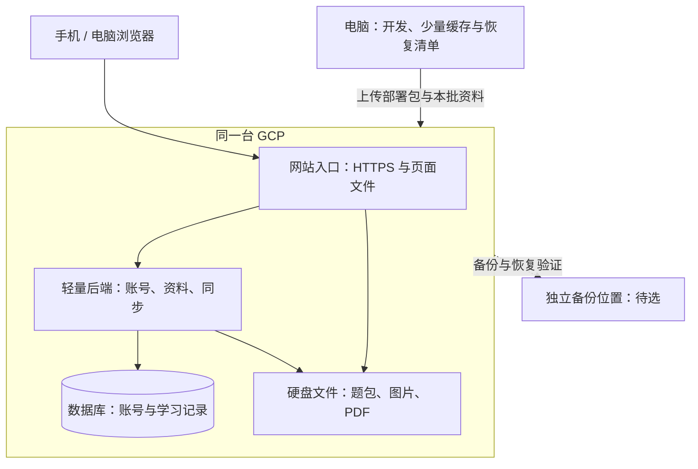

# BitAtlas 自托管下一阶段方案

状态：原咨询方案，后续已批准并实现服务器版，2026-11-21 又完成 GCP 回环部署、私有资料上传及加密历史归档。当前范围以 [实施合同](server/implementation.md)、[账号迁移](server/migration-v5.md)和[GCP 验收记录](server/gcp-deployment-2026-11-21.md)为准；下方“尚未实现/未备份”等是咨询时点。域名入口、独立远端自动备份及本机约 1GB 目标仍未完成；没有修改 DNS/CI 或永久删除历史材料。

## 建议的最终形态

一台美国 GCP 集中提供前端页面、轻量后端、数据库及初期题库/图片/PDF。电脑只常驻开发所需文件、少量资料缓存及恢复清单；历史证据远端归档，完整备份不再默认保存在电脑。独立备份目的地尚待选择，可用现有北京节点仅存受控的加密备份，也可用单独远端存储；不要求北京节点参与账号、阅读或同步请求。日本节点按用户所述即将到期，不承担长期依赖。

设计目标为约 10–19 位受邀用户；验收拟用 20 个模拟用户覆盖并发学习情景。这是下一阶段的目标，不是已验证的容量结论。GCP 精确机型、后台进程、可用内存、网络档位、国内直连质量与账单仍需核实。

图中是职责分工，不代表要创建多台主机或多个服务商账户。受限资料须经后端权限检查后才交付，不能仅隐藏页面入口。

技术候选：复用 React 前端和 TypeScript 领域/schema 包；用 Nginx 或现有兼容 Web 服务提供页面并转发 API；新增单进程 TypeScript 后端；SQLite 存结构化信息，文件系统保存资料。SQLite 文件留在后端本机，由 API 访问，不让浏览器或多台服务器直接读写共享数据库文件。SQLite 官方明确支持低中流量网站和应用服务器场景，同时存在单写者边界。[2][3]

服务器保存正式账号、共享内容、权限及已同步的个人数据；浏览器保存最近阅读内容、主动选择的离线资料和待同步操作。服务器与浏览器分工不意味着推翻已有练习、复习和实验模块。同步前先明确数据归属、冲突策略及恢复规则。

## 本机约 1 GB 的具体口径与迁移要求

用户的约束是非开发常驻文件尽量不超过约 1 GB；先按更节省空间的目标设计，让项目开发目录加应用缓存也尽量落在 1,000,000,000 bytes 内。该值是日常预算，完整测试或 OCR 批次可能短时超出，执行前应估计临时峰值，完成后归档处理。浏览器全局安装、其他站点数据及通用开发工具不算本项目专属文件，但不得通过把项目副本移入另一个本机目录规避统计。

2026-11-20 本轮项目专项只读扫描（逻辑字节）：

| 项目 | 文件数 / 字节数 | 含义 |
|---|---:|---|
| 整个项目目录 | 6,154,650,774 bytes，约 5.73 GiB | 未含浏览器用户目录、回收站及全局工具 |
| `output/` | 20,469 文件 / 5,505,693,970 bytes，约 5.13 GiB | 主要是历史与验收证据，需归档，不是可直接删除的垃圾 |
| 去掉 `output/` 后的整个项目 | 648,956,804 bytes，约 619 MiB | 已含源码、Git、依赖、现有资料，表明日常约 1 GB 目标有实现空间 |
| 根 `node_modules/` | 305,129,667 bytes，约 291 MiB | 当前开发依赖，另有 Web workspace 依赖，不能直接当垃圾 |
| `local-data/` | 170,837,766 bytes，约 163 MiB | 来源资料、OCR 与生成输入，迁出须保真 |

扫描记录为 `output/storage-plan-2026-11-20/project-inventory.json`；跳过 7 个 workspace 链接防止重复统计，无读取失败。扫描没有修改原始文件；其后新增的小型报告/文档不包含在该时点总量中。未读取浏览器实际用量，不能声称整机现已低于 1 GB，也不能把逻辑字节当作可释放物理空间。

建议的日常预算：

| 本机内容 | 预算 | 处理方式 |
|---|---:|---|
| 源码、Git、开发依赖和必要测试素材 | 约 400–650 MB | 保留可开发、可验证的最小完整工作区；目前完整非 output 目录已约 649 MB |
| 应用缓存及最近使用资料 | 约 250 MB | 按需加载；离线整份 PDF 由用户主动选择，纳入预算 |
| 归档索引、恢复说明、下载暂存 | 约 50 MB | 大资料用可恢复分块上传或在线阅读；不常驻整套备份 |
| 合计 | 约 700–950 MB | 规划预算，须在实现后同时测目录和浏览器占用 |

- **资料和历史证据迁出。** 先保存来源路径、相对路径、文件长度、SHA-256 与版本的清单；归档应保留报告到 trace/截图/日志的关系。优先直接流式传到私有远端位置，或分批迁移，避免电脑上再生成一份约 5 GB 的整包。若要本地压缩暂存，事先列出额外空间需求。
- **恢复和本地副本处置。** 远端逐文件/归档完整性核验并完成恢复演练，保留本地小型索引和恢复入口；来源材料和历史证据不得沿用“可再生垃圾”的清理例外。后续另列精确本地处置白名单；永久删除和清空回收站仍需明确授权。未提交的源码修改、现用依赖和 Git 历史保留。
- **缓存预算需要实现。** 现有 `storage.ts` 会预热已安装题包资产，`document-library.ts` 的 128 MiB 限制针对单份 PDF，当前没有全站 250 MB 总量合同。后续须增加按需下载、最近使用淘汰和用量显示；不能仅更换服务器就声称本机占用受控。
- **不能淘汰唯一数据。** 未同步作答、笔记草稿、个人卡和导入中的唯一 PDF 应保护；达到预算时先停止新的下载并提示同步/迁移，不能靠删除唯一副本达标。已固定的离线资料不能静默移除；可下载副本按权限和版本重新获取。用量显示应结合受应用管理的文件字节统计并留余量；浏览器 `StorageManager.estimate()` 的口径及差异在实现前依据 [5] 复核，本轮未取得可用官方响应。
- **完整备份放远端。** 方案不接受 GCP 同盘另放一个目录作为唯一灾难恢复副本。候选为独立远端加密备份，或核实磁盘支持与费用后的云盘快照；要求数据库有一致快照，资料版本和恢复密钥可独立取回。若选择快照路线，须依据 [4] 验证应用一致性并另评估账号失效后的恢复方式；本轮未取得可用官方响应，未据此选定或开通服务。北京腾讯云仅是备份目的地候选，电脑不承担完整常驻备份。
- **服务器空间也有预算。** 前次探针约 25.27 GB 未用属于原核验时点；归档约 5.13 GiB 历史证据也消耗远端空间，不自动成为站点公开资源。迁移前重查可用容量，给系统、日志、更新及恢复留空间；备份目标、压缩率、传输费用和可恢复性尚未验证。

## “静态托管平台”与当前项目的关系

- 当前仓库的 `README.md`、`docs/RELEASE.md`、`.github/workflows/deploy.yml` 明确配置 GitHub Pages；工作流构建并上传 `apps/web/dist`，自定义域名由 `apps/web/public/CNAME` 声明。本次未查询实时 DNS 或 GitHub 控制台，结论是当前仓库配置及已记录发布方式。
- GitHub Pages 是替用户提供 HTML/CSS/JavaScript 文件的网站托管服务。[1] “静态”描述文件的交付方式，不等于页面不能交互。
- 自己的服务器同样能提供这些文件。Nginx 官方指南同时覆盖静态文件服务与反向代理 API。[2] 因此，把前端迁入 GCP 后仍可保持现有前端结构。
- DeepSeek v2 报告第 1 节记录参考网站由 OpenResty 提供前端文件，另有 API 域名和资源域名。报告没有证明使用 GitHub Pages 等托管平台，也没有证明底层一定是一台自有 VPS。域名、Web 服务软件和云托管平台是不同层次的概念。
- 参考网站情况仅来自 2026-11-19 已有报告，本轮未在线探测；其资源域名不能单独证明具体存储供应商。详见 `docs/server-capacity-2026-11-20.md` 中的报告对照。

## 实施顺序与每步交付

### 1. 先准备完整的单机服务基础

- 只读盘点 GCP 的已有服务、进程内存、端口、磁盘、网络档位和实际出站费用，确认可共存边界。
- 先明确本机空间口径、私有归档目录及独立备份目的地，再为历史证据和来源资料准备可核验迁移清单；本轮未进行上传或本地清理。
- 先在本地完成后端骨架、健康检查、受控配置、部署包和回滚流程；前端与 API 从同一站点入口访问。
- 增加管理员与邀请制成员账号；提供登录、退出、账号停用、会话撤销和必要的恢复流程。凭据只进入受保护配置。
- 实施前更新项目规范中的新阶段范围；新后端 schema 与既有浏览器 schema 分别设计，不因部署需求随意重置学习记录。
- 交付：可本地运行的整套应用、安装/升级/回滚说明，以及初步资源测量。正式服务器安装与配置在方案明确后单独授权执行。

### 2. 把资料集中起来

- 管理员可导入通过现有校验的题包、学习包和 PDF，管理年份、科目、来源、版本、可见范围和文件摘要。
- PDF/图片保存为服务器文件，数据库保存目录与权限信息。初期资料先用 GCP 现有硬盘；公开素材与受限资料分别处理。
- 浏览器按需获取资料，默认约 250 MB 应用缓存预算；保留用户主动选择的离线下载并计入用量，不把资料库全量下载到每台设备。该预算机制尚未实现。
- 原来仅在浏览器保存的 PDF 和学习备份分别处理；已有备份不含 PDF 字节，不暗示可以一次备份自动搬完。
- 交付：本人在电脑上传一份资料，登录手机后能找到并阅读；其他账号只看到获准资料。文件更新不破坏旧学习证据的版本关联。

### 3. 接上学习记录同步

- 先覆盖笔记、错题、作答、个人卡与复习记录，再接每日计划和进行中会话。
- 旧本地数据先生成恢复快照，再由本人明确归入对应账号；不自动把共享浏览器所有历史记录归给首次登录者。
- 同步采用增量提交与幂等标识；笔记冲突保留双方原文。每日计划由统一规则生成并保存，跨设备不会因刷新重排；进行中会话需定义设备切换和并发编辑边界。
- 登录切换、退出与离线模式须隔离不同用户的数据。与账号相关的请求和缓存不能混用。
- 交付：电脑做题后手机能续学；断网继续操作，恢复网络后能同步；重复请求和双设备编辑不丢记录。

### 4. 验收、备份恢复，再切换入口

- 负载目标：20 个模拟活跃用户按实际学习节奏进行登录、阅读、保存与同步；另做首次同步和同时 PDF 阅读场景。注册账号数不替代并发测试。
- 正确性目标：用户隔离、文件访问控制、重复提交、断网恢复、笔记冲突、磁盘/存储失败反馈、旧数据导入和备份恢复。
- 测量新增服务与已有服务共存时的 CPU、进程 RSS、MemAvailable、活跃换页、API 延迟及实际传输量；据结果决定资源调整，不预先承诺 1 GB 在所有情景都够。
- 备份需覆盖一致数据库快照、对应版本资料及恢复说明，保存到选定的独立远端位置并实际做恢复演练；电脑仅保留恢复清单。北京服务器可作备份目的地但不是应用的必要组件；本轮没有创建备份或计划任务。
- 本机空间验收同时检查项目目录、下载暂存及应用浏览器存储；验证连续阅读、多份 PDF、更新、离线重开和未同步写入达到预算时的行为。完整测试产物迁出后重新计量，分别报告逻辑占用、回收站占用与实际空闲空间。
- 迁移时尽量保持原 HTTPS 域名与路径；校验旧 PWA 更新、离线恢复、内容深链接和登录行为。切流前留可回退版本。
- 用户确认实际部署、配置及 DNS 变更后再执行线上切换。当前 GitHub Pages 可以在迁移验证期间继续提供原站点。

## 范围

本阶段优先完成自用及十几人测试所需的账号、集中资料、同步和恢复。当前方案不引入额外托管平台；若实测资料体积或下载费用成为瓶颈，再评估独立对象存储。

已有学习内容审核状态、题包公开范围、Q44 边界和备份兼容合同继续适用。将材料放入服务器不自动获得公开发布授权。保留此前门禁与压力测试记录；本轮为咨询文档，不重复运行产品测试。

## 核验入口

- 当前托管配置：`README.md:80`、`.github/workflows/deploy.yml`、`apps/web/public/CNAME`
- 当前架构：`docs/ARCHITECTURE.md`
- 容量与同类平台对照：`docs/server-capacity-2026-11-20.md`
- 原参考报告：`D:/DshWork/CyberWork/50_reports/20261119-T20261119-03-408os-reverse-spec-v2.md:36`
- [1] GitHub Pages 官方说明：`https://docs.github.com/en/pages/getting-started-with-github-pages/what-is-github-pages`
- [2] Nginx 官方入门指南：`https://nginx.org/en/docs/beginners_guide.html`
- [3] SQLite 官方适用场景：`https://www.sqlite.org/whentouse.html`
- [4] 待复核：Google Cloud 磁盘快照最佳实践：`https://docs.cloud.google.com/compute/docs/disks/snapshot-best-practices`
- [5] 待复核：MDN `StorageManager.estimate()`：`https://developer.mozilla.org/en-US/docs/Web/API/StorageManager/estimate`
